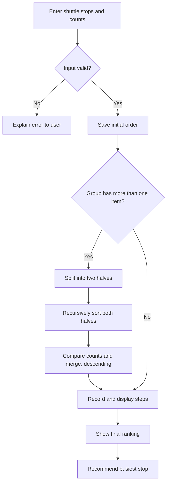

# Shuttle Stop Crowd Ranking — Merge Sort Simulator

**Course:** CISC 121 (Fall 2026)  
**Student:** Zian Wang  
**Student ID:** 20623376  
**Algorithm:** Merge Sort (only)  
**Computing problem:** Shuttle Stop Crowd Ranking (only)

## Chosen Problem

A campus transport planner enters shuttle stop names and estimated numbers of waiting riders. The app ranks stops from busiest to least busy to inform a hypothetical extra-shuttle dispatch decision. Data are user-provided or fictional examples, **not real-time Queen's University crowd measurements**.

## Algorithm and Rationale

This project implements **stable Merge Sort from scratch**. Merge Sort recursively splits records into halves, sorts smaller groups, and merges them by comparing rider counts. It is a good choice because the comparison/merge stages are easy to explain visually and its time complexity is **O(n log n)**. The algorithm requires no prior ordering. The left item wins when counts tie, preserving original order (stability). The application **does not call Python sorted(), list.sort(), or another sorting library to rank records**.

**Input constraints:** one `Stop name,count` per line; between 1 and 24 records; unique names (case-insensitive) of 1–32 characters without commas; nonnegative whole-number counts from 0 to 100000. Invalid input raises an actionable error. Output is a descending ranking, the busiest-stop recommendation, and recorded animation steps.

## Demo and Visual Explanation

The app shows a horizontal bar for each stop, an explanation for the current step, and a final ranking. The bar chart uses:
- **Blue:** currently active split/merge group
- **Teal:** records under comparison or just merged
- **Grey:** other records

Choose **Run Merge Sort** and use **Previous**, **Next**, **Final result**, or the step slider to inspect the algorithm. Use **Add stop** or edit the data box to provide your own input, then run again.

**Screenshot evidence:** Six genuine screenshots were captured from the deployed application on November 18, 2026: default Start, default Finished, intermediate Merge, stable equal-count ranking, single stop, and invalid input. See [TESTING.md](TESTING.md) for observed results. The images are included in the separate evidence archive, not yet in this GitHub repository.

## Problem Breakdown & Computational Thinking

**Decomposition**
1. Read and validate user-input stops.
2. Recursively split the list into smaller groups.
3. Compare rider counts; merge each pair of sorted groups.
4. Capture steps for the teaching interface.
5. Render the ranked list and recommend the busiest stop.

**Pattern recognition:** each merge repeatedly compares the next unprocessed stop from two sorted groups, selects the larger count, and continues until both groups are exhausted.

**Abstraction:** display stop name, count, order, compared items and active segment; hide recursion stack details and low-level indexes that do not help a beginner. The crowd counts are estimates.

**Algorithm design:** Gradio input → validation → recursive Merge Sort + snapshots → step-by-step visualization → final ranking.

### Flowchart



## Installation and Local Run

Python 3.10+ is recommended. From the `FinalProject` folder:

```bash
python -m pip install -r requirements.txt
python app.py
```

Open the local Gradio URL printed in the terminal (usually http://127.0.0.1:7860). The third-party dependency is Gradio; other modules are in the Python standard library.

## Tests and Verification

Run `python -m unittest -v` from this directory. Nine automated tests (rerun locally on November 18, 2026: 9 passed, 0 failed) cover typical inputs, single stop, equal counts, zero and maximum counts, reverse ordering, invalid numbers, invalid names, stop-limit enforcement and explanatory output.

| Case | Input | Expected |
|---|---|---|
| Typical | Union 45, Library 20, Residence 70, Gym 35 | 70, 45, 35, 20 |
| Single | Only 0 | 0 |
| Equal counts | First 7, Second 7, Third 10 | Third, First, Second |
| Maximum and zero | A 0, B 100000, C 2 | B, C, A |
| Reverse sorted | A 0, B 1, C 2, D 3 | D, C, B, A |
| Invalid | A -1, A 2.5, A hello | Helpful error |
| Duplicate stop | A 1 and a 3 | Helpful error |
| Too many stops | 25 entries | Helpful error |

**Deployment status (November 18, 2026):** The Python/Gradio application is running on Render and was manually verified in a browser using the default five-stop data, including the initial and final simulation steps. The Hugging Face Static Space embeds the externally hosted Render app in an iframe; Python does **not** run on Hugging Face. This may not satisfy an assignment that specifically requires a native Gradio Space. Nine automated tests were rerun locally and passed. The hosting arrangement remains subject to instructor approval.

## Links

**GitHub:** https://github.com/Zian520521/cisc121/tree/main/FinalProject  
**Hugging Face Space (Static embed):** https://huggingface.co/spaces/Frank520521/cisc121-shuttle-merge-sort  
**Python/Gradio host (Render):** https://cisc121-shuttle-merge-sort.onrender.com

## Author, Acknowledgment and Resources

Zian Wang — 20623376. OpenAI ChatGPT (GPT-6) assisted with the app design, implementation, tests and README. The student's responsibility is to review the source, run the application, verify deployment, and submit according to the assignment policy (which allows up to Level 4 AI assistance).

- CISC 121 Project Guidelines, Fall 2026 (Queen's University course handout)
- [Gradio documentation](https://www.gradio.app/docs/gradio/blocks)
- [Hugging Face Spaces](https://huggingface.co/docs/hub/spaces)

## Before OnQ Submission

- [x] Merge Sort code and Gradio interface
- [x] README, four computational-thinking pillars, and flowchart
- [x] Nine automated tests (9/9 passing) and browser test report
- [x] Capture six actual application screenshots (included in separate evidence archive; not yet uploaded to GitHub)
- [x] Publish Hugging Face Static Space with embedded Render Gradio app and verify default-case UI
- [x] Add Space URL above
- [ ] Confirm that an externally hosted iframe is accepted for the Hugging Face requirement
- [ ] Submit **GitHub and Hugging Face Space links** on OnQ by December 8, 2026, 11:59 PM
